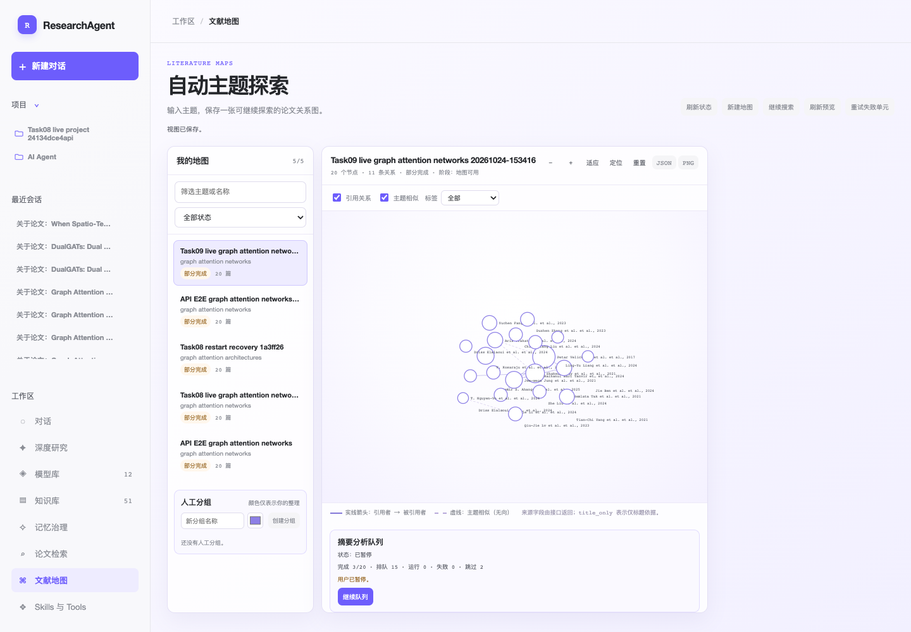

# Task09 真实浏览器 E2E 验收报告

结论：`BLOCKED`

本报告只记录当前候选部署的真实 Chromium 页面与真实 HTTP 请求。没有使用 fixture、mock、内部函数、假地图或拦截请求；没有修改业务代码/测试，没有启动或停止服务，没有执行知识库导入/下载。完整脱敏请求摘要见同目录 [`api-e2e.json`](api-e2e.json)，阶段交接见 [`stage-result.md`](stage-result.md)。

## 1. 运行环境与范围

- 服务：`http://127.0.0.1:8000/`，`GET /api/health` 返回 HTTP 200。
- 代码候选：`458da1b35238691cbe9447c71bf7a1afbb08728f`。
- 实际资源：`literature-maps.js?v=16`、`literature-maps.css?v=12`、`app.js?v=60`。
- 隔离真实浏览器：Chromium `136.0.7103.25`，独立 headless context；未导航或破坏用户已有浏览器 tab。
- 运行目录：`20261024-153416-task09-live-graph`。
- 真实 fresh 地图由并行 API 验收步骤创建，本代理只从产品地图入口打开并验证；没有凭空创建替代数据。

Fresh 实体：

- `map_id=858b78f0d9e047efa6d8d1559d83a6de`，名称 `Task09 live graph attention networks 20261024-153416`，owner `local-user`，`project_id=null`，请求 20 篇。
- 选中节点：`node_id=3ddd16f157414d3c81b31171107e317b`，标题 `Graph Attention Networks`，2017，第一作者 `Petar Velickovic`，真实来源 Semantic Scholar。
- 摘要来源版本：`c518a10f28b2656ae30f53790a67ef835c8ebe219168460969b763f481d1e42c`。

## 2. 真实地图与队列状态

真实页面渲染出 20 个节点、11 条关系、20 个标签；没有 page error。打开已有地图触发了页面批准范围内的 `POST .../analysis-queue/ensure`（HTTP 202），没有触发新地图创建。

实际观察到的队列状态轨迹：

1. 暂停态：页面显示“状态：已暂停 / 完成 3/20 · 排队 15 · 运行 0 · 失败 0 · 跳过 2 / 用户已暂停。”，并显示“继续队列”。
2. 运行态：页面显示“完成 13/20 · 排队 4 · 运行 1 · 失败 0 · 跳过 2”，按钮为“暂停队列”。
3. 终态：真实 `GET /api/literature-maps/858b78f0d9e047efa6d8d1559d83a6de/analysis-queue` 返回 `state=completed`、`total=20`、`completed=18`、`queued=0`、`running=0`、`failed=0`、`skipped=2`；页面显示“状态：已完成 / 完成 18/20 · 排队 0 · 运行 0 · 失败 0 · 跳过 2”，并保留“重试失败单元”。

地图 graph 响应的 `map.status` 仍为 `partial`，与 2 个 skipped 节点相符；报告不把“有 skipped 的 partial 地图”改写成全量成功。页面队列计数与 API 队列计数一致。



## 3. 标签三档与节点可访问性

真实选择器 `#literature-map-label-mode` 的三档实测如下：

| 模式 | 节点数 | 标签数 | 结果 |
|---|---:|---:|---|
| `all` | 20 | 20 | 通过数量与稳定位置检查 |
| `neighbors` | 20 | 7 | 通过；为选中节点、去重邻居及必要标签 |
| `hidden` | 20 | 0 | 通过；节点仍有 `role=button`、`tabindex=0`、完整 `title/aria-label` |

三档切换没有改变节点位置或关系边。未观察到 `undefined`、`null` 或空白标签。但真实多作者短标签出现：

> `Petar Velickovic et al. et al., 2017`
> `Shaked Brody et al. et al., 2021`

这不是测试数据制造的字符串，而是当前候选部署的实际 DOM 文本；“et al.” 被重复拼接，违反单次短标签格式。该用户可见缺陷按 P1/FAIL 记录，不在本轮修改。

全部 20 个真实 DOM 标签（含 node ID）已保存在 [`label-audit.json`](label-audit.json)；其中 20/20 均含作者与年份，0 个为 `undefined`/`null`/空白，但可见文本均暴露了重复 `et al.` 组合问题。

## 4. 引用数半径与选中态

20 个真实节点逐项读取 `data-citation-count` 与 SVG `circle[r]`，均满足：

```text
min(28, 8 + 2 * ln(1 + citation_count)) ± 0.01
```

代表值：`29148 → 28`、`2183 → 23.3778267`、`681 → 21.0500593`、`77 → 16.7134`。选中 `Graph Attention Networks` 前后半径均为 `28`，差异仅为 `is-selected` class/描边。Fresh 图的 20 个节点都有合法 citation count，没有 `null/缺失` 样本，因此“未知引用数固定最小半径与未知文案”在本次真实实体上未能验证，不能宣称通过。

## 5. 鼠标锚点、工具栏中心、详情与页面滚动

使用实际 `page.mouse` wheel 和实际工具栏按钮，读取 `#literature-map-viewport` 的 `translate(x y) scale(s)`，把屏幕点换算为 viewBox 世界坐标：

- 非中心留白点滚轮：变换从 `translate(0 0) scale(1)` 到 `translate(-6.204190444946292 -3.792731857299806) scale(1.1)`；锚点前后差值约 `(-0.090,-0.139)`，≤1.0 viewBox 单位；页面滚动 `0→0`。
- 工具栏“放大”：以可视画布中心为锚点，变换到 `translate(-96 -68) scale(1.2)`；世界坐标差值约 `(-0.00002,-0.00001)`，≤1.0。
- 详情与页面滚动复测：打开节点详情、页面滚动到 260px 后在同一非中心点滚轮；详情仍可见，页面仍为 260px，锚点差值约 `(-0.090,0.00002)`，≤1.0。

以上每次都用真实重置视图按钮收尾，保存请求为预期 view 更新，没有创建地图或伪造事件。

## 6. 详情、摘要/全文页签与全文未就绪引导

节点详情实际显示：标题、作者、2017、venue、引用数 29148、真实摘要，以及“打开原文”“加入知识库”“移出地图”“参考文献”“引用它的论文”。分析区域实际显示：

- “可用依据：摘要级”；
- “全文索引尚未就绪；请先主动入库并等待索引完成。”；
- “摘要”页签可用；“全文”页签可切换查看未就绪说明；“基于全文分析”按钮为 disabled；
- 未观察到切换全文页签后的 `POST analyses`、导入请求或下载请求。

历史摘要版本显示为 `v1 · 摘要级 · 已完成`，正文非空。截图见 [`02-task09-node-detail-and-labels.png`](screenshots/02-task09-node-detail-and-labels.png)。

### 历史全文 ready 只读回放

用户指定的历史实体只作历史回归，不计入本轮 fresh 门禁：

- `map_id=0baabeae7268429c9f7e4de8098ae1d0`、`node_id=21041260a5394f42891b020128fa60fa`。
- 真实 API GET 返回 `download_status=indexed`、`source_status.fulltext_ready=true`、`available_evidence_levels=[abstract, full]`，全文 source version 为 `a253fa60f4d0444592fd52f89e23016e8d437f01335f300b176d610eeefa644c`；历史全文分析也是既有 completed 记录。
- 真实浏览器地图中该指定节点与重叠节点成组，几何中心命中 SVG；通过真实可访问操作将节点聚焦后按 `Enter` 成功激活，未用 `dispatchEvent` 或内部调用绕过。切换真实“全文”页签后，页面显示“可用依据：摘要级、全文索引片段依据”、全文 source version `a253fa60f4d0444592fd52f89e23016e8d437f01335f300b176d610eeefa644c`，历史版本显示 `v2 · 全文索引片段依据 · 已完成` 与“全文分析结果（全文索引片段依据）”；“基于全文分析”和“重新生成全文（会调用模型）”均可用。此次仅切页签，没有触发全文分析 POST、导入或下载。该历史回放证明了 ready 页面文案与手动按钮，但不替代当前 fresh 实体门禁。

## 7. 一次手动再生成与旧结果保留

在 fresh 节点已有 v1 已完成摘要时，真实点击一次“重新生成摘要（会调用模型）”：

- `POST /api/literature-maps/858b78f0d9e047efa6d8d1559d83a6de/nodes/3ddd16f157414d3c81b31171107e317b/analyses` 返回 HTTP 202；
- 请求 `evidence_level=abstract`，响应 `analysis_id=42cf77712d7c430fb4b4311a3d573931`、`job_id=3264b0f9e3cf4e5f9183c9e4a6faf95c`、v2 `queued/pending`；
- 点击后约 1.5 秒内，页面仍显示 v1 “已完成”及摘要正文，同时显示 v2“生成中”，证明旧结果没有被清空；
- 这是本轮唯一一次手动 regenerate；此后没有再次触发。脱敏请求与实体 ID 见 `api-e2e.json`。

之后的只读 GET 在本地运行记录中能看到该 analysis 的状态变化；协调方另报告了 provider `RATE_LIMITED`/迟到 v2 的阻塞背景。因此本报告只把“点击时旧结果保留”记为通过，不把 v2 的最终模型结果计作本轮成功，也不重复等待或触发昂贵模型。

## 8. “关于本篇提问”：已有草稿不覆盖，空草稿预填且不发送

### 8.1 已有草稿

在真实主聊天输入框 `#question` 先填入 `用户已有草稿：请不要覆盖`，再从 fresh 节点点击“关于本篇提问”：

- 真实会话 POST 返回 HTTP 200，`conversation_id=b8bca6e24a6c4145b119cec3c532d6a3`、`project_id=null`、`evidence_level=abstract`、`source_version=c518a10f…d1e42c`；
- 页面跳到 `/c/b8bca6e24a6c4145b119cec3c532d6a3`；
- `#question` 仍为原始草稿，出现“插入建议问题”操作；
- 没有 `/messages` POST、SSE 或用户/助手消息增加。

### 8.2 空草稿

在隔离真实浏览器 context 中保持 `#question` 为空并重复同一节点提问入口：

- 真实会话 POST 返回 HTTP 200，`conversation_id=291f001105df42e6ac37d009dd0654ae`，`project_id=null`，`evidence_level=abstract`；
- `#question` 预填为可编辑文本，包含标题、作者/第一作者、年份 2017，以及“研究问题、方法、主要结论、局限、证据等级”；
- 没有消息 POST、SSE、自动发送或草稿覆盖。

这两次真实会话均只验证打开、预填和保留，不发送消息；会话 ID 不是 fixture。

## 9. 人工验收案例（当前不可交付）

入口：`http://127.0.0.1:8000/#literature-maps-view`；候选资源版本见第 1 节；前置条件为能看到地图卡片 `Task09 live graph attention networks 20261024-153416`。

1. 点击主导航“文献地图”，找到上述地图卡片并点击。点击后应看到 20 个节点、11 条关系；等待节点数量稳定为 20，页面没有错误。若仍是生成中，等待“地图可用”或队列状态变化；超时则保留当前队列提示并重新打开该地图，不创建第二张地图。
2. 点击真实节点 `Graph Attention Networks`。点击后应出现真实详情、摘要级分析与队列计数；等待详情加载完成。若节点重叠，按可见节点边缘点击；也可聚焦可访问节点后按 `Enter` 激活，不能用脚本事件绕过。
3. 将标签模式切换为“全部”“仅邻居/相邻”“隐藏”（页面实际 value 为 `all/neighbors/hidden`），分别等待 DOM 标签数稳定为 20/7/0；隐藏时用 `aria-label/title` 确认节点仍可选。若看到重复 `et al.`，停止验收并记录 `LABEL-ETAL-DUP`，不要以截图或手工文本修饰通过。
4. 在画布非中心留白处滚轮一次，检查画布缩放；等待视图稳定且页面滚动位置不变。点击工具栏“重置视图”恢复。若锚点漂移超过 1.0 viewBox 单位，记录 `ZOOM-ANCHOR`。
5. 在详情中查看“摘要/全文”页签。当前 fresh 地图应看到“全文索引尚未就绪；请先主动入库并等待索引完成。”以及禁用的全文分析按钮；不要点击“加入知识库”，不要下载或导入。若需要全文就绪，必须由允许的外部来源流程另行解除，不得在本案例中伪造 ready。
6. 查看“摘要分析队列”。暂停态点击“继续队列”，运行态等待完成计数变化；终态应看到完成/排队/运行/失败/跳过计数。失败时只点击“重试失败单元”，不要重复提交整个队列。当前真实终态为 18/20 completed、2 skipped。
7. 对已有摘要只允许点击一次“重新生成摘要（会调用模型）”，等待明确的 queued/running/completed/failed 文案；在等待期间必须仍能阅读 v1 正文。若 provider rate limited/failed，保留旧结果，记录错误和重试入口，不再次连续触发模型。
8. 点击“关于本篇提问”。如果 `#question` 已有草稿，确认原文仍在并使用“插入建议问题”作为显式后续操作；若为空，确认预填含标题、作者、年份、研究问题、方法、主要结论、局限、证据等级。只有用户另行点击发送才允许消息 POST；本案例到此不发送。

当前不允许把上述步骤交给最终用户作为通过验收，因为存在真实重复 `et al.` 缺陷、fresh 全文仍未就绪，且模型侧有 RATE_LIMITED/迟到 v2 阻塞；历史全文 ready 只读页面本身已验证。

## 10. 准备度矩阵

| # | 门项 | 结果 | 证据 |
|---:|---|---|---|
| 1 | 服务已启动并可访问 | PASS | `/api/health` 200；报告第 1 节 |
| 2 | 真实 API 创建入口/新鲜实体 | PASS（由并行 API 验收提供实体） | fresh `map_id` 与 graph/queue |
| 3 | 主路径参数解析 | PASS（本代理验证地图实体与节点入口） | 真实地图名、topic、node 详情 |
| 4 | 状态从初始态推进 | PASS | generating → graph → paused/running/completed |
| 5 | 前端显示处理中提示 | PASS | 暂停/运行、v2“生成中”、全文未就绪文案 |
| 6 | 用户知道何时等待/点击 | PASS | “继续队列”“暂停队列”“重试失败单元”、全文下一步文案 |
| 7 | 核心产物真实生成 | FAIL/不完整 | 20 节点真实生成，但 2 skipped；全文 ready 不在 fresh 候选 |
| 8 | 失败状态有可操作恢复 | PASS（已观察到入口） | “重试失败单元”、旧摘要保留；provider RATE_LIMITED 仍需协调方闭环 |
| 9 | 页面状态与 API 状态一致 | PASS（队列）/风险 | 队列计数一致；graph `map.status=partial` 已明确记录 |
| 10 | 无上下文用户可复现步骤 | FAIL | 发现 `LABEL-ETAL-DUP`；fresh 全文门禁与模型侧 RATE_LIMITED 阻塞未解除 |

计分：按严格门禁不计不完整核心产物与不可复现项，未达到可交付条件；即使按宽松计分也不能覆盖 P1 标签缺陷、全文门禁缺失和 provider 阻塞。

## 11. 阻塞与后续

1. 修复并复测多作者短标签重复 `et al.`；复测应覆盖真实页面 DOM，不只做静态字符串检查。
2. 为当前候选提供真实 owner/project allowlist 下的全文 ready 节点；历史 full-ready 页面已只读验证，但不能替代 fresh 实体门禁。
3. 协调 API 队列/模型侧确认 `RATE_LIMITED` 与迟到 v2 的最终状态，确认旧摘要保留与失败恢复；本代理不再重复 regenerate。
4. 完成上述解除后，重新生成新的 run ID 与不可覆盖证据，不覆盖本次失败/部分证据。

最终裁决：`BLOCKED`。当前不建议交给用户做最终人工验收。

## 主会话证据裁决补记（2026-10-24，非独立复验）

- 浏览器验收者已明确确认 `42cf77712d7c430fb4b4311a3d573931` 是其唯一主动重新生成请求。相同source version的手动新版属于已确认行为，不能据此指认自动ensure重复；保留上文初始风险记录，当前不以它判定产品缺陷。
- `SEMANTIC_SCHOLAR_RATE_LIMITED` 来自元数据/引用provider，不是模型错误；建图partial与摘要队列completed为独立状态。2篇无摘要跳过是既定安全行为，不能单凭skipped推导建图partial原因或要求标题级伪分析。
- fresh节点未下载全文属于本阶段正常前置条件，不要求自动下载；旧真实full-ready节点的UI读验证仅证明该分支，不冒充本轮新生成全文成功。全文/入库真实成功仍待用户指定最后处理的导入缺陷阶段补验。
- 当前明确用户可见缺陷为 `LABEL-ETAL-DUP`，已交开发修复，故本报告BLOCKED结论暂不改；不把上述澄清当成新候选独立通过证据。

## v17 标签窄复验补记（2026-10-24 15:56，历史失败证据保留）

后续独立 run [`20261024-155602-task09-label-v17`](../20261024-155602-task09-label-v17/task-09-browser-e2e.md) 在同一 fresh map 上实际加载 `literature-maps.js?v=17`，20/20 标签均为单一 `et al.` + 四位年份，`pageerror=0`；该窄能力结论为 `PASS_NARROW_LABEL_REVIEW/GO`。本节不覆盖本报告原始 run 的 `LABEL-ETAL-DUP` 失败证据，也不把标签窄通过扩展成整个 Task09/Spec 通过。

事实校正：唯一手动摘要再生成 `42cf77712d7c430fb4b4311a3d573931` 是验收者明确执行的合法动作，不是自动 ensure 重复；v17 只读复核前后分析版本仍为 v1/v2 两条且均 completed，未新增版本。fresh 全文未 ready 是当前前置条件，页面未自动下载或入库，不应作为自动下载缺陷；`SEMANTIC_SCHOLAR_RATE_LIMITED` 是来源/元数据状态，不是模型失败。真实 `partial`、18 completed/2 skipped，以及最终知识库/全文 ready 门禁待办继续保留。
