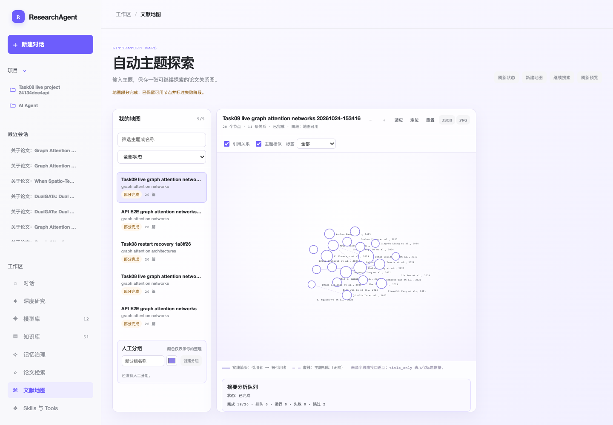

# Task09 v17 标签窄复验

结论：`PASS_NARROW_LABEL_REVIEW`（仅标签能力；不覆盖旧 run 的整体验收结论）。

旧 run 的完整报告与历史失败证据保留在 [`20261024-153416-task09-live-graph/task-09-browser-e2e.md`](../20261024-153416-task09-live-graph/task-09-browser-e2e.md)。本次只验证 v17 fresh-map 标签，不触发 regenerate、下载或知识库导入；详细脱敏记录见 [`browser-e2e.json`](browser-e2e.json)。

## 真实环境

- 服务：`http://127.0.0.1:8000/`，隔离新 Chromium context。
- 浏览器：Chromium `136.0.7103.25`。
- 实际资源：`literature-maps.js?v=17`、`literature-maps.css?v=12`、`app.js?v=60`。
- Fresh map：`858b78f0d9e047efa6d8d1559d83a6de`，名称 `Task09 live graph attention networks 20261024-153416`。

## 验证结果

从产品入口“文献地图”打开既有 fresh map，实际渲染 20 个节点、11 条关系、20 个标签。`all` 标签模式逐项读取真实 DOM：

- 20/20 标签包含第一作者短名、恰好一次 `et al.` 与四位年份；例如 `Petar Velickovic et al., 2017`、`Shaked Brody et al., 2021`。
- 20/20 无 `undefined`、`null` 或空标签。
- `pageerror` 为 0，无 JavaScript exception。
- 页面实际加载 `literature-maps.js?v=17`；本次没有触发 `POST .../analyses`、导入、下载或 regenerate。
- 打开既有地图仅观察到批准范围内的 `POST .../analysis-queue/ensure`；节点分析版本打开前后均为 v1 completed + v2 completed，ID/版本/状态完全不变，未产生额外版本。
- API/页面仍保留真实 `partial` 地图与队列终态：20 total、18 completed、2 skipped、0 failed；本窄复验不将 partial 改写为全量成功。

本次浏览器控制台另有 4 条通用 failed-resource 404 文本，但 `pageerror=0`，未观察到 JavaScript 错误；它们不影响本窄标签结论，原始观察已写入 JSON。

## 对旧报告的事实修正

- 手动摘要再生成是本代理按验收授权执行的唯一一次合法动作；v2 `analysis_id=42cf77712d7c430fb4b4311a3d573931` 已在本次只读复核中保持 completed，旧报告中“迟到 v2 风险”的表述只保留为当时观察，不应被解释为浏览器重复触发或非法动作。
- fresh map 全文未 ready 仍是当前真实资源状态；页面显示未就绪引导，不自动下载、不自动入库，不属于本次标签复验失败。
- S2 `RATE_LIMITED` 只作为来源/元数据侧状态记录，不将其归因于模型失败；本次未触发任何模型请求。
- 真实地图 `partial`、18 completed/2 skipped，以及最终知识库/全文 ready 门禁待办继续保留。

## 窄复验裁决

`GO` 仅适用于 v17 标签能力：重复 `et al.` 缺陷已消失，20/20 作者-年份标签通过，且没有新增分析版本或禁止写请求。不得据此覆盖旧 run 中缩放、队列、全文、会话等证据，也不得宣称最终 Spec 已可交用户验收。
